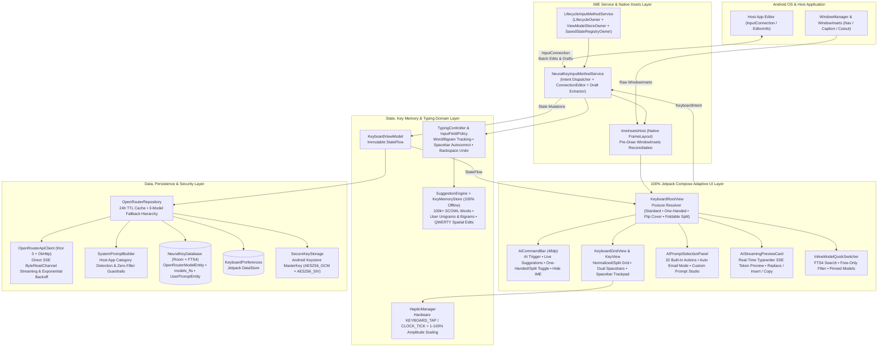
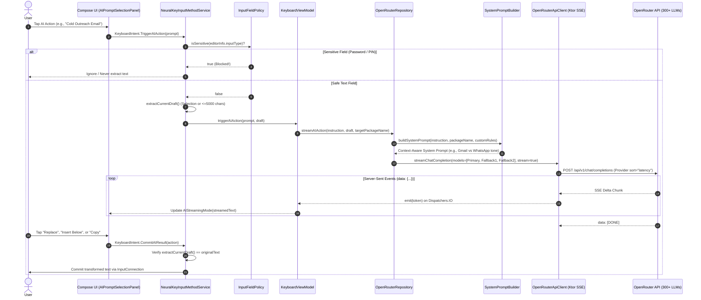
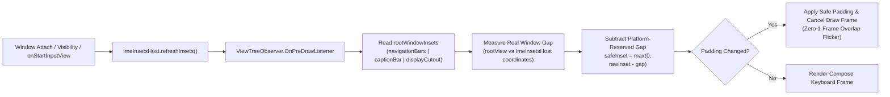

<div align="center">

# 🧠 NeuralKey AI Keyboard
### *100% Free, Open-Source, Zero-Telemetry Intelligent Android IME*

**Built natively with 100% Jetpack Compose • Kotlin 2.1 • Neural Trail Glide Typing • Internet GIF & Sticker Studio • Scribe v2 & Multimodal Voice-to-Action • Slash Commands & Offline Math Macros • Multi-Model Arena Split-Compare • Smart Clipboard AI Fusion • Adaptive On-Device Key Memory • Foldable & One-Handed Postures • 15 Flagship Themes**

[](https://github.com/rzrmayur/NeuralKey-AI-Keyboard/releases/latest)
[](https://github.com/rzrmayur/NeuralKey-AI-Keyboard/actions)
[](#-free-for-all-manifesto)
[](LICENSE)

[-3DDC84?style=flat-square&logo=android&logoColor=white)](https://developer.android.com)
[](#-deep-dive-one-handed-mode--foldable--flip-posture-engine)
[](https://kotlinlang.org)
[](https://developer.android.com/jetpack/compose)
[](https://ktor.io)
[-F97316?style=flat-square)](https://openrouter.ai)

<br />

[**⬇️ Download Latest APK (v1.3.0)**](https://github.com/rzrmayur/NeuralKey-AI-Keyboard/releases/latest) • [**🔥 What's New in v1.3.0**](#-whats-new-in-v130--the-futuristic-neural-suite) • [**✨ Features**](#-key-capabilities--feature-matrix) • [**🏗️ Architecture**](#️-system-architecture--data-flow) • [**🧠 Key Memory**](#-deep-dive-adaptive-key-memory--offline-scowl-engine) • [**📱 Fold & One-Handed**](#-deep-dive-one-handed-mode--foldable--flip-posture-engine) • [**🔒 Security**](#-defense-in-depth-security--privacy-architecture) • [**🚀 Quick Start**](#-installation--zero-cost-setup-guide)

</div>

---

## 📑 Table of Contents

1. [🌍 Free-for-All Manifesto (Why NeuralKey Exists)](#-free-for-all-manifesto)
2. [🔥 What's New in v1.3.0 — The Futuristic Neural Suite](#-whats-new-in-v130--the-futuristic-neural-suite)
3. [⚡ Key Capabilities & Competitive Matrix](#-key-capabilities--feature-matrix)
4. [🏗️ System Architecture & Unidirectional Data Flow](#️-system-architecture--data-flow)
5. [🧠 Deep Dive: Context-Aware AI Engine, Email Suite & SSE Streaming](#-deep-dive-context-aware-ai-engine-email-suite--sse-streaming)
6. [📚 Deep Dive: Adaptive Key Memory & Offline SCOWL Engine](#-deep-dive-adaptive-key-memory--offline-scowl-engine)
7. [📱 Deep Dive: One-Handed Mode & Foldable / Flip Posture Engine](#-deep-dive-one-handed-mode--foldable--flip-posture-engine)
8. [📐 Deep Dive: OEM WindowInsets Reconciliation (`ImeInsetsHost`)](#-deep-dive-oem-windowinsets-reconciliation-imeinsetshost)
9. [🎨 15 Flagship Themes & Tactile Hardware Haptics](#-15-flagship-themes--tactile-hardware-haptics)
10. [🔒 Defense-in-Depth Security & Privacy Architecture](#-defense-in-depth-security--privacy-architecture)
11. [🚀 Installation & Zero-Cost Setup Guide](#-installation--zero-cost-setup-guide)
12. [🛠️ Building from Source & CI Verification Suite](#️-building-from-source--ci-verification-suite)
13. [👨‍💻 About the Creator & Project Mission](#-about-the-creator--project-mission)

---

## 🌍 Free-for-All Manifesto

> [!IMPORTANT]
> **NeuralKey AI Keyboard is—and will always remain—100% FREE for everyone.**
> There are **no subscriptions**, **no paywalls**, **no in-app purchases**, **no advertisements**, **no user tracking**, and **no proprietary middleman servers**.

Most commercial "AI keyboards" on mobile stores charge **$9.99–$19.99/month**, route every keystroke through opaque third-party servers, lock features behind paywalls, and inject bloatware into your daily typing experience. **NeuralKey AI Keyboard** was engineered to shatter that model:

| Pillar | How NeuralKey Delivers It for $0.00 |
| :--- | :--- |
| **🆓 100% Free Application** | Released under the permissive **Apache 2.0 License**. Every feature, all **15 dynamic themes**, all **32 AI actions** (including the Email Drafts Suite), custom prompt studio, One-Handed/Foldable layouts, and Adaptive Key Memory are unlocked out of the box for everyone. |
| **⚡ Zero-Cost AI Inference (`:free` LLMs)** | Supports **OpenRouter's Free Tier** natively. Toggle the built-in **`⚡ Free Models Only`** filter in the Model Explorer or inline switcher to run powerful free models (e.g., *Mistral 7B Instruct Free*, *Llama 3.3 Free*, *Gemini Flash Free*, *DeepSeek Free*) at **$0.00 cost**. |
| **📴 100% Offline Daily Typing & Key Memory** | Word completions, Adaptive Key Memory learning, N-gram next-word predictions, and spacebar autocorrection run **entirely on-device** using a bundled **100,000+ word SCOWL English dictionary**. Everyday typing never touches the network and never requires an account or API key. |
| **🔗 Direct Bring-Your-Own-Key (BYOK)** | Your device connects **directly** to `https://openrouter.ai/api/v1` over TLS. There is zero developer proxy server between your keyboard and the inference engine. |

---

## 🔥 What's New in v1.3.0 — The Futuristic Neural Suite

See full release notes in [`docs/releases/v1.3.0.md`](docs/releases/v1.3.0.md), [`docs/releases/v1.2.0.md`](docs/releases/v1.2.0.md), [`docs/releases/v1.1.1.md`](docs/releases/v1.1.1.md), and [`docs/releases/v1.1.0.md`](docs/releases/v1.1.0.md).

- **🪄 Ghost-Text Inline AI Autocomplete & Per-App AI Personas (`AppPersonaEngine`):**
  - Automatically detects the active foreground app and adapts AI tone, formatting, and Ghost-Text sentence completion across **6 specialized personas**: `✉️ Email Mode` (Gmail/Outlook), `💬 Chat Mode` (WhatsApp/Telegram/Signal/Discord), `💼 Workspace Mode` (Slack/Teams/Notion), `💻 Dev Mode` (GitHub/Termux/IDEs), `🔥 Social Mode` (X/LinkedIn/Reddit), and `🧠 Universal AI`.
  - Tap **`🪄 Ghost Complete`** in AI Studio to seamlessly finish your unfinished sentence or paragraph inline while preserving your exact opening words.
- **⚡ Neural Trail Glide / Swipe-to-Type (`SuggestionEngine.decodeGlidePath` & `KeyboardGridView`):**
  - Slide your finger continuously across character keys to decode full words **100% offline** using anchor start/end matching, ordered subsequence scoring, QWERTY spatial adjacency, and your personal **Key Memory** unigrams/bigrams.
  - Renders a multi-layered glowing neon comet trail (`outer halo` + `mid energy beam` + `inner white core` + `comet head orb`) dynamically tinted to your active theme's primary and secondary accents.
- **📋 Smart Clipboard Time-Machine & AI Context Fusion (`ClipboardHistoryManager` & `ClipboardFusionPanel`):**
  - Stores up to 25 recent non-sensitive clipboard items on-device (respecting Android 13+ `EXTRA_IS_SENSITIVE` so passwords are never captured) with 1-tap **Pin**, **Delete**, and **Clear Unpinned**.
  - **1-Tap AI Context Fusion (`💬 AI Reply`):** Combines a copied incoming message from your clipboard with your current draft notes to write a complete, context-aware reply—plus 1-tap **📝 TL;DR** and **🌐 Translate** on any clip.
- **⚔️ Multi-Model Arena Split-Compare (`ArenaComparePanel`):**
  - Streams **2 OpenRouter LLMs side-by-side in parallel** inside the keyboard, displaying live token generation, per-model latency (`ms`), and 1-tap **`✓ Use Model A` / `✓ Use Model B`** winner selection.
- **💻 In-Keyboard Slash Commands & Dynamic Offline Macros (`SlashCommandEngine`):**
  - **Zero-Latency Offline Macros (on `Space` or `Enter`):** `/calc <math>` (safe recursive-descent math parser supporting `+ - * / % ^` and parentheses, e.g., `/calc (12+8)*3.5` $\rightarrow$ `70`), `/date`, `/time`, `/datetime`, `/clip`, `/shrug` (`¯\_(ツ)_/¯`), and `/tableflip`.
  - **Instant AI & Media Slash Commands:** Type `/email`, `/fix`, `/tldr`, `/polite`, `/sql`, `/regex`, `/code`, `/translate`, `/slovak` (`/sk`), `/gif <query>`, or `/sticker <query>` and press `Space` or `Enter` to trigger instant AI streaming or open the GIF & Sticker Studio—with live slash-command autocomplete in the suggestion bar as soon as you type `/`.
- **🎙️ Scribe v2 / Voxtral / Multimodal Voice-to-Action Studio (`VoiceToActionPanel` & `VoiceAudioEngine`):**
  - **Configured Exclusively for Voice-Capable OpenRouter Models:** Choose directly between **ElevenLabs Scribe v2 (`elevenlabs/scribe-v2`)**, **Mistral Voxtral (`mistralai/voxtral-mini-transcribe` & `mistralai/voxtral-small-24b-2507`)**, **Google Gemini 2.5 Flash Audio (`google/gemini-2.5-flash`)**, **OpenAI GPT Audio Mini & Whisper Large v3 Turbo**, **Qwen 3.8 Omni Flash**, and **100% Free ($0.00) Audio Models (`nvidia/nemotron-3-nano-omni-30b-a3b-reasoning:free`, `thinkingmachines/inkling:free`)**.
  - **16kHz HD PCM WAV Recording + Zero Repetitive Words:** Hardware 16kHz mono PCM recorder (`WavAudioRecorder`) with `NoiseSuppressor` + `AutomaticGainControl` and multi-stage n-gram stutter/repeat deduplication (`VoiceAudioEngine.cleanRepetitiveSpeech` & `mergeRecognizedSegment`), transforming speech into **`✨ Smart Polish`**, **`✉️ Voice → Email`**, **`📋 Voice → Bullets`**, **`🌐 Voice → English`**, **`🇸🇰 Voice → Slovak`**, or **`✍️ Raw Text`**.
- **🎬 Internet-Wide GIF & Sticker Search Studio (`GifStickerSearchPanel` & `GifStickerRepository`):**
  - Search across the largest open/free collections on the internet right inside the keyboard (**🎬 GIPHY Global GIFs**, **✨ GIPHY Transparent Animated Stickers**, **🌐 Wikimedia Commons Open-Source GIFs**, and **😎 Google Open-Source Apache-2.0 Noto Animated Emoji Stickers**) with an inline mini-QWERTY search bar, 16 reaction chips, and direct animated GIF insertion via `InputConnectionCompat.commitContent`.
- **🇸🇰 Slovak (`Slovenčina`) Translation & 33 Built-In AI Actions:**
  - Added **`🇸🇰 Translate to Slovak`** (`Slovenčina`) across the AI Prompt Studio, `/slovak` & `/sk` slash commands, and `Voice → Slovak`.
- **🛡️ Hardened OpenRouter Error Diagnostics & Automatic Free-Tier Recovery (`OpenRouterApiClient` & `OpenRouterRepository`):**
  - Detailed, actionable HTTP status diagnostics (`400`, `401/403`, `402`, `404`, `408`, `429`, `5xx`) + automatic fallback to `openrouter/free` if a primary model is rate-limited or out of credits.

### Previous Highlights (`v1.2.0`)
- **🧠 Adaptive On-Device Key Memory & N-Gram Next-Word Predictions (`KeyMemoryStore` + `SuggestionEngine`):**
  - Automatically learns your personal vocabulary, custom names/jargon, preferred capitalization, and contextual word-to-word transitions (`previousWord -> nextWord`) 100% offline.
  - Predicts the **top 3 likely next words** immediately after pressing Space, and boosts QWERTY spatially adjacent typo fixes.
  - Includes a dedicated **Smart Typing** studio in Settings to teach custom words or wipe Key Memory in 1 tap.
- **📱 One-Handed Mode & Foldable / Flip Device Postures (`DeviceKeyboardPosture`):**
  - **One-Handed Mode (`LEFT` / `RIGHT`):** Compacts the keyboard to `82%` width anchored to either side with an `18%` quick-action dock sidebar to flip sides (`◀` / `▶`) or expand to full width (`⤢`).
  - **Unfolded Foldable Split Mode:** Automatically detects unfolded inner displays (`>= 600dp`, e.g., Galaxy Z Fold, Pixel Pro Fold, OnePlus Open, tablets) and splits the key grid into left/right thumb clusters with an ergonomic central gap and **dual thumb spacebars**.
  - **Flip Phone Cover Screen Compact Mode:** Automatically compacts row heights on short cover screens (`<= 440dp`, e.g., Galaxy Z Flip / Razr) so the host editor stays visible.
- **✉️ 32 Built-In AI Actions (New Email Drafts & Smart Writing Suites):**
  - Added 6 dedicated **Email & Drafts** tools (*Reply: Confirm & Accept*, *Reply: Polite Decline*, *Cold Outreach Email*, *Follow-Up Nudge*, *Meeting Recap & Actions*, *Subject Line Generator*) with automatic **✉️ Email Mode** detection in Gmail/Outlook.
  - Added 4 **Smart Writing & Engineering** tools (*Expand & Elaborate*, *Brainstorm 5 Angles*, *Pros, Cons & Risks*, *Bug / Jira Spec*) plus *Translate to German*.
- **🎨 15 Flagship Themes & Modernized Animated Dashboard (`SettingsActivity`):**
  - Added 6 new themes: **Dracula Pro** 🧛, **Nordic Frost** ❄️, **Mocha Espresso** ☕, **Carbon Titanium** 🏎️, **Abyssal Biolume** 🌊, and **Rose Quartz** 🌹.
  - Completely redesigned the companion app with a pulsing status pill, live telemetry strip, spring-animated tab transitions, interactive key-physics theme mockup, and custom AI tool builder.

---

## ⚡ Key Capabilities & Feature Matrix

### Why Choose NeuralKey Over Mainstream Keyboards?

| Capability | 🧠 NeuralKey AI Keyboard | 💰 Commercial AI Keyboards | 📱 Stock / Legacy Keyboards |
| :--- | :---: | :---: | :---: |
| **Price & Licensing** | **100% Free & Open Source (Apache 2.0)** | $8–$20/mo Subscription | Free (Often closed-source) |
| **Telemetry & Keystroke Logging** | **Zero Telemetry / Air-Gapped Backup Rules** | Cloud analytics & keystroke profiling | Vendor cloud sync |
| **Adaptive Key Memory** | **100% On-Device Unigram & Bigram Learning** | Cloud-synced user profiling | Cloud-synced |
| **Foldable & Flip Support** | **Auto Split on Fold (≥600dp) + Flip Cover Compact + One-Handed** | Fixed phone layout | Varies by OEM |
| **AI Model Choice** | **300+ Models (Gemini, Claude, Llama, DeepSeek, GPT)** | Locked to 1 vendor-chosen model | None or single vendor ecosystem |
| **Free AI Tier Support** | **Native `⚡ Free Models Only` Filter** | ❌ Paywalled after 3–5 trials | ❌ Varies |
| **Email & Productivity Suite** | **32 Built-In Actions + Custom Prompt Builder** | Basic rewrite only | ❌ None |
| **API Key Storage** | **Hardware Keystore AES-256-GCM (Fail-Closed)** | Stored on vendor backend | N/A |

---

## 🏗️ System Architecture & Data Flow

NeuralKey AI Keyboard is architected around a strict **Model-View-Intent (MVI)** unidirectional data flow inside a custom lifecycle-aware Android `InputMethodService`.

### High-Level Component Architecture



---

## 🧠 Deep Dive: Context-Aware AI Engine, Email Suite & SSE Streaming

### Real-Time Token Streaming Pipeline



### 🎭 32 Built-In AI Action Prompts Across 6 Categories

When opened inside an email app (`Gmail`, `Outlook`, `Thunderbird`, `Spark`), NeuralKey automatically activates **✉️ Email Mode** and surfaces the **Email & Drafts** category first:

<details>
<summary><b>📋 View All 32 Built-In AI Prompts & Instructions (Click to Expand)</b></summary>

<br />

| # | Category | Action Title | System Task Specification |
| :-: | :--- | :--- | :--- |
| 1 | **Email & Drafts** | **Reply: Confirm & Accept** | Transform notes/draft into a warm, structured professional email reply confirming receipt, accepting the proposal/meeting, and stating next steps. |
| 2 | **Email & Drafts** | **Reply: Polite Decline** | Draft a gracious, diplomatic email reply that politely declines the request or proposal while preserving goodwill. |
| 3 | **Email & Drafts** | **Cold Outreach Email** | Turn notes into a concise, high-converting executive cold outreach email with a compelling hook, value proposition, and low-friction CTA. |
| 4 | **Email & Drafts** | **Follow-Up Nudge** | Write a courteous, action-oriented follow-up email checking in on a previous thread or pending deliverable without sounding pushy. |
| 5 | **Email & Drafts** | **Meeting Recap & Actions** | Transform rough meeting notes into a structured executive recap email with Summary, Key Decisions, and Action Items with Owners. |
| 6 | **Email & Drafts** | **Subject Line Generator** | Generate 3 high-impact email subject lines (Executive, Urgent/Direct, Conversational) plus a 1-line preview text. |
| 7 | **Productivity** | **Polish** | Elevate phrasing, enhance flow, and improve clarity while keeping the exact meaning and tone intact. |
| 8 | **Productivity** | **Fix Grammar** | Correct all spelling, grammatical, punctuation, and capitalization errors without altering intended meaning. |
| 9 | **Productivity** | **Professional** | Rewrite into a courteous, polished, and professional tone suitable for workplace or client communication. |
| 10 | **Productivity** | **TL;DR Crisp** | Condense into a punchy, ultra-concise summary of 1–2 sentences max. |
| 11 | **Productivity** | **Diplomatic** | Soften message to be exceptionally polite, constructive, and conflict-diffusing while preserving boundaries. |
| 12 | **Productivity** | **Bullet Points** | Structure draft into clean, formatted bullet points with clear takeaways or action items. |
| 13 | **Productivity** | **Explain Like I'm 5** | Rewrite in extremely simple, friendly, everyday words that a 5-year-old could easily understand. |
| 14 | **Smart Writing** | **Expand & Elaborate** | Expand shorthand notes or a brief thought into a well-structured, articulate, and persuasive paragraph. |
| 15 | **Smart Writing** | **Brainstorm 5 Angles** | Generate 5 distinct, creative angles, hooks, or strategic approaches in numbered bullet points. |
| 16 | **Smart Writing** | **Pros, Cons & Risks** | Analyze the proposal or idea and output a structured breakdown of Pros, Cons, and Potential Blind Spots / Risks. |
| 17 | **Smart Writing** | **Bug / Jira Spec** | Convert a rough issue or feature description into a structured software engineering ticket with Summary, Steps, and Acceptance Criteria. |
| 18 | **Humor & Vibes** | **Playful Roast** | Rewrite with witty, sharp, comedic banter and playful roast energy without being genuinely malicious. |
| 19 | **Humor & Vibes** | **Sarcastic & Dry** | Rewrite dripping with clever, dry, deadpan sarcasm and subtle irony while communicating the essential point. |
| 20 | **Humor & Vibes** | **Gen-Z Slang** | Rewrite into modern Gen-Z / internet slang (*no cap, fr fr, high key, main character, bet*) with emojis. |
| 21 | **Humor & Vibes** | **Shakespearean** | Translate into dramatic, grand Elizabethan English complete with poetic rhetoric and theatrical flair. |
| 22 | **Humor & Vibes** | **Pirate Talk** | Rewrite in authentic, colorful, swashbuckling pirate vernacular with nautical terms and hearty enthusiasm. |
| 23 | **Humor & Vibes** | **Cyberpunk 2077** | Rewrite as a gritty, neon-soaked cyberpunk comms transmission from an underworld netrunner. |
| 24 | **Styles** | **Casual & Chill** | Rewrite into a relaxed, friendly, effortless conversational chat tone for texting friends or informal DMs. |
| 25 | **Styles** | **Charming & Smooth** | Rewrite with effortless charm, subtle wit, warm charisma, and engaging banter. |
| 26 | **Styles** | **Maximum Hype** | Inject explosive energy, massive excitement, bold motivational drive, and celebratory vibes. |
| 27 | **Styles** | **Stoic / Zen** | Rewrite from a calm, grounded Stoic philosophy perspective: rational, unbothered, and composed. |
| 28 | **Translation** | **Translate to English** | Translate into fluent, natural, idiomatic English. |
| 29 | **Translation** | **Translate to Spanish** | Translate into natural, fluent Spanish (*Español*). |
| 30 | **Translation** | **Translate to French** | Translate into elegant, natural French (*Français*). |
| 31 | **Translation** | **Translate to German** | Translate into natural, fluent, idiomatic German (*Deutsch*). |
| 32 | **Translation** | **Translate to Japanese** | Translate into polite, natural Japanese (*日本語*). |

</details>

---

## 📚 Deep Dive: Adaptive Key Memory & Offline SCOWL Engine

NeuralKey combines a bundled **100,000+ word SCOWL English dictionary** (`assets/english_words.dict`) with an on-device **Adaptive Key Memory Engine** (`KeyMemoryStore` + `SuggestionEngine`):

1. **On-Device Unigram & Custom Casing Memory (`recordWord`):**
   - Learns words you type or select in normal text fields (strictly disabled in password, URI, and email fields via `InputFieldPolicy`).
   - Remembers custom proper nouns, names, and technical terms (preserving custom capitalization like `"NeuralKey"`) and protects your learned words from ever being mistakenly autocorrected away.
2. **Contextual Bigram Next-Word Prediction (`nextWordSuggestions`):**
   - Learns word-pair transitions (`previousWord -> nextWord`) alongside built-in conversational/business bigrams (e.g., `"thank" -> "you"`, `"looking" -> "forward"`, `"best" -> "regards"`).
   - Immediately after pressing Space, the toolbar displays the top 3 predicted next words for 1-tap insertion.
3. **QWERTY Spatial Proximity Typo Ranking (`isQwertyNeighborSubstitution`):**
   - When evaluating 1-edit substitution candidates (e.g., `hellp` $\rightarrow$ `hello`), substitutions involving physically adjacent keys on the QWERTY grid are ranked ahead of distant key substitutions.
4. **Single-Backspace Undo (`TypingController`):**
   - Pressing `⌫ Backspace` immediately after an automatic spacebar correction atomically restores your exact original spelling, rolls back the replacement from Key Memory, and learns your original word instead.

---

## 📱 Deep Dive: One-Handed Mode & Foldable / Flip Posture Engine

NeuralKey adapts dynamically to every modern Android form factor via `resolveDevicePosture`:

| Device Form Factor / Posture | Trigger Condition | Adaptive Layout Behavior |
| :--- | :--- | :--- |
| **📱 Standard Phone (Full Width)** | Portrait `< 600dp` width | Full-width normalized QWERTY grid with 1-tap One-Handed toggle (`PhonelinkSetup` icon) on the command bar. |
| **🤚 One-Handed Mode (`LEFT` / `RIGHT`)** | User-selected via Toolbar or Settings | Compacts the keyboard to **82% width** anchored to the left or right thumb edge, with an **18% quick-action dock** to flip hands (`◀` / `▶`) or expand to full width (`⤢`). |
| **📖 Unfolded Foldable / Tablet (`FOLDABLE_UNFOLDED`)** | `width >= 600dp` & `height >= 480dp` | Automatically activates the **Ergonomic Thumb-Split Layout** (`Q W E R T` \| gap \| `Y U I O P`) with **dual left/right spacebars** and an inline split-toggle icon on the command bar. |
| **📟 Flip Phone Cover Screen (`FLIP_COVER_COMPACT`)** | `height <= 440dp` portrait | Compacts key rows to `178dp` total grid height so Galaxy Z Flip / Motorola Razr cover displays keep the host text box unobstructed. |
| **🔄 Landscape Multi-Window (`LANDSCAPE_COMPACT`)** | `ORIENTATION_LANDSCAPE` | Disables fullscreen IME takeover (`onEvaluateFullscreenMode() = false`) and compacts grid height to `150dp`. |

---

## 📐 Deep Dive: OEM WindowInsets Reconciliation (`ImeInsetsHost`)



---

## 🎨 15 Flagship Themes & Tactile Hardware Haptics

NeuralKey includes **15 instant-switching themes** with zero-restart reactivity and an interactive physics preview mockup inside the Settings dashboard:

| Theme | ID | Style | Primary Accent | Secondary Accent | Visual Character |
| :--- | :--- | :---: | :---: | :---: | :--- |
| 🎨 **Dynamic (Material You)** | `SYSTEM_DYNAMIC` | Dark / Adaptive | Wallpaper Dynamic | Wallpaper Dynamic | Adapts in real time to Android 12+ (`API 31+`) Monet wallpaper palettes. |
| ⚡ **Cyberpunk Neon** | `CYBERPUNK_NEON` | Dark | `#00E5FF` | `#F43F5E` | High-voltage electric cyan & neon fuchsia on deep violet-black. |
| 🖤 **Midnight OLED** | `MIDNIGHT_OLED` | Pure AMOLED | `#38BDF8` | `#818CF8` | `#000000` pitch-black power saver with crisp white typography. |
| ✨ **Aurora Glass** | `AURORA_GLASS` | Dark | `#2DD4BF` | `#60A5FA` | Luminous northern lights emerald & sapphire frosted glass. |
| 🌸 **Tokyo Night** | `TOKYO_NIGHT` | Dark | `#7AA2F7` | `#F7768E` | Iconic Japanese synthwave aesthetics with pastel blue & sakura pink. |
| 🌅 **Sunset Horizon** | `SUNSET_HORIZON` | Dark | `#FB7185` | `#FBBF24` | Warm twilight dusk fading into coral pink and golden amber. |
| 💚 **Emerald Matrix** | `EMERALD_MATRIX` | Dark | `#10B981` | `#34D399` | Futuristic terminal obsidian with glowing radioactive green. |
| 🌌 **Deep Space** | `DEEP_SPACE` | Dark | `#7C4DFF` | `#00E5FF` | Cosmic nebula dark navy with royal ultraviolet & pulsar cyan. |
| 🧛 **Dracula Pro** | `DRACULA_PRO` | Dark | `#BD93F9` | `#FF79C6` | Gothic midnight slate with electric vampire purple & neon pink. |
| ❄️ **Nordic Frost** | `NORDIC_FROST` | Dark | `#88C0D0` | `#81A1C1` | Arctic polar night slate with glacial ice cyan & frost blue. |
| ☕ **Mocha Espresso** | `MOCHA_ESPRESSO` | Dark | `#FAB387` | `#CBA6F7` | Cozy dark-roast espresso with warm caramel peach & soft lavender. |
| 🏎️ **Carbon Titanium** | `CARBON_TITANIUM` | Dark / Stealth | `#FF6B00` | `#F59E0B` | Brushed stealth gunmetal carbon with hyper-orange mechanical legends. |
| 🌊 **Abyssal Biolume** | `ABYSSAL_BIOLUME` | Dark | `#00F5D4` | `#FF5E7E` | Deep ocean trench midnight teal with bioluminescent aqua & coral. |
| 🌹 **Rose Quartz** | `ROSE_QUARTZ` | Light Studio | `#E11D48` | `#FB7185` | Soft luxury daylight blush studio with crimson rose accents. |
| ☀️ **Chalk Studio** | `CHALK_STUDIO` | Light Studio | `#2563EB` | `#0EA5E9` | Clean Scandinavian daylight studio with royal blue accents. |

---

## 🔒 Defense-in-Depth Security & Privacy Architecture

1. **Hardware-Backed Keystore Encryption (`SecureKeyStorage.kt`):**
   - Your OpenRouter API key is encrypted using an Android Keystore `MasterKey` (`AES256_GCM`) inside `EncryptedSharedPreferences` (`AES256_SIV` key encryption + `AES256_GCM` value encryption) with a strict **fail-closed guarantee**.
2. **Zero Cloud Backup or Device-Transfer Exfiltration (`data_extraction_rules.xml`):**
   - Explicitly excludes `root`, `file`, `database`, `sharedpref`, and `external` domains from both Android `<cloud-backup>` and `<device-transfer>`.
3. **Password & Sensitive Input Isolation (`InputFieldPolicy.kt`):**
   - Blocks draft extraction, AI menu actions, Key Memory learning, and word suggestions inside all password, email, and URI fields.
4. **Stale-Draft Mutation Protection:**
   - Verifies `extractCurrentDraft() == streamingState.originalText` before applying any AI replacement.

---

## 🚀 Installation & Zero-Cost Setup Guide

### Step 1: Download & Install the APK
1. Go to the [**GitHub Releases Page**](https://github.com/rzrmayur/NeuralKey-AI-Keyboard/releases/latest) and download `NeuralKey-AI-Keyboard-v1.3.0.apk`.
2. Verify the download integrity against `SHA256SUMS.txt` if desired:
   ```bash
   sha256sum -c SHA256SUMS.txt
   ```
3. Install the APK on your Android device (**Android 11 / API 30 or higher**).

### Step 2: Activate via the 2-Step Wizard
1. Open **NeuralKey AI** from your app launcher.
2. Under the **Setup** tab, complete **Step 1 ("Enable")** and **Step 2 ("Select")**.

### Step 3: Use AI for 100% Free ($0.00 Setup)
1. Create a free account at [OpenRouter.ai](https://openrouter.ai/keys) and generate an API key (`sk-or-v1-...`) — **no credit card or paid balance is required to use `:free` models!**
2. Paste your key into the **OpenRouter API Vault** card and tap **Save Key**.
3. Open the **Models** tab, tap **`Sync Live`**, toggle **`⚡ Free Models Only`**, and select any `FREE ($0.00)` model.

---

## 🛠️ Building from Source & CI Verification Suite

```bash
# 1. Clone the repository
git clone https://github.com/rzrmayur/NeuralKey-AI-Keyboard.git
cd NeuralKey-AI-Keyboard

# 2. Run the full automated unit, Key Memory, Robolectric layout, foldable & inset test suite
./gradlew :app:testDebugUnitTest

# 3. Run Android Lint static analysis
./gradlew :app:lintDebug

# 4. Assemble the installable Debug APK
./gradlew :app:assembleDebug
```

### Automated Test & Validation Matrix

| Test Suite | Target Component | What It Verifies |
| :--- | :--- | :--- |
| [`DictionaryAssetTest`](app/src/test/java/com/supakeyboard/neuralkey/ime/typing/DictionaryAssetTest.kt) | `assets/english_words.dict` | Verifies GZIP decompression, $>100,000$ SCOWL vocabulary integrity, and bundled license notices. |
| [`SuggestionEngineTest`](app/src/test/java/com/supakeyboard/neuralkey/ime/typing/SuggestionEngineTest.kt) | `SuggestionEngine.kt` | Prefix completions, Key Memory custom vocabulary & rank boosting, contextual bigram next-word prediction, and QWERTY spatial neighbor detection. |
| [`TypingControllerTest`](app/src/test/java/com/supakeyboard/neuralkey/ime/typing/TypingControllerTest.kt) | `TypingController.kt` | Word composition tracking, spacebar replacement, single-backspace undo restoration, next-word selection after space, and bigram learning. |
| [`InputFieldPolicyTest`](app/src/test/java/com/supakeyboard/neuralkey/ime/typing/InputFieldPolicyTest.kt) | `InputFieldPolicy.kt` | Bitmask isolation for text/web/visible/numeric passwords, URIs, email fields, and `FLAG_NO_SUGGESTIONS`. |
| [`ImeInsetsHostTest`](app/src/test/java/com/supakeyboard/neuralkey/ime/ui/ImeInsetsHostTest.kt) | `ImeInsetsHost.kt` | Native View inset reconciliation across API 30 & 35, delayed caption-bar delivery, consumed child insets, and side cutouts. |
| [`KeyboardLayoutTest`](app/src/test/java/com/supakeyboard/neuralkey/ime/ui/KeyboardLayoutTest.kt) | `KeyboardRootView.kt` | 48dp command bar stability, One-Handed mode compacting & side-switching, Foldable (`w673dp-h841dp`) split layout with dual spacebars, Flip cover (`h400dp`) compact posture, 15 themes, 32 AI prompts, and height-locked `ClipboardFusionMode`, `ArenaCompareMode`, & `VoiceActionMode` overlays. |
| [`FuturisticFeaturesTest`](app/src/test/java/com/supakeyboard/neuralkey/ime/FuturisticFeaturesTest.kt) | `SlashCommandEngine.kt` / `AppPersonaEngine.kt` / `ClipboardHistoryManager.kt` / `OpenRouterApiClient.kt` | Offline `/calc` math parser, `/date`/`/shrug`/`/clip` macros, `/email`/`/sql` AI slash commands, Neural Trail Glide decoding, Per-App AI Persona auto-detection, Clipboard Context Fusion, and OpenRouter HTTP error diagnostics (`401`/`402`/`429`/`503`). |
| [`SettingsDashboardLayoutTest`](app/src/test/java/com/supakeyboard/neuralkey/ui/settings/SettingsDashboardLayoutTest.kt) | `SettingsActivity.kt` | Verifies single-line horizontal header badge (`Setup Needed`, `v1.3 FREE`) and tab layout bounds on compact `w360dp-h780dp` screens across all 5 tabs. |

---

## 👨‍💻 About the Creator & Project Mission

Hi! I'm **Mayur ([@rzrmayur](https://github.com/rzrmayur))**, the creator and maintainer of **NeuralKey AI Keyboard**.

I built **NeuralKey AI Keyboard** because I believe intelligent, privacy-respecting writing tools should be a **public good—accessible to everyone around the world for free**, without expensive monthly AI subscriptions, middleman servers, or keystroke tracking.

### 🤝 Contributing & Community Support
1. **Star ⭐ this repository** to help more people discover a free, open-source AI keyboard!
2. Open an [Issue](https://github.com/rzrmayur/NeuralKey-AI-Keyboard/issues) for bug reports or feature requests.
3. Submit a [Pull Request](https://github.com/rzrmayur/NeuralKey-AI-Keyboard/pulls) with improvements.

---

## 📄 License & Attributions

- **Source Code:** Licensed under the [**Apache License, Version 2.0**](LICENSE). Free for personal, academic, and commercial use.
- **Bundled Offline English Dictionary:** Derived from [**SCOWL (Spell Checker Oriented Word Lists)**](app/src/main/assets/licenses/english-dictionary.txt) by Kevin Atkinson and contributors.
