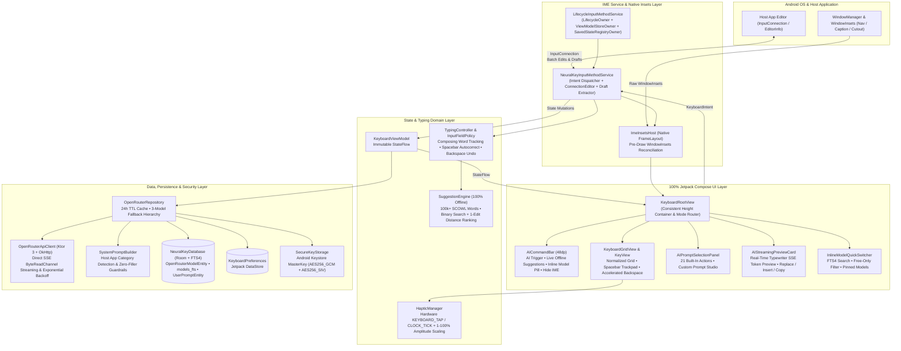
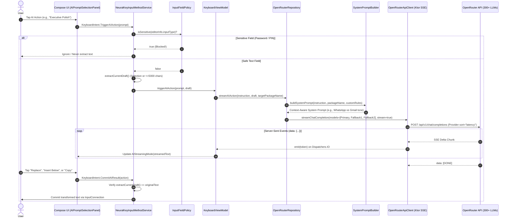
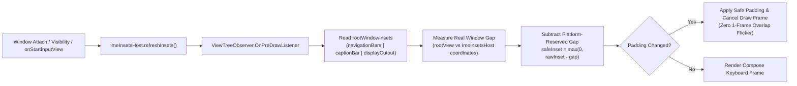

<div align="center">

# 🧠 NeuralKey AI Keyboard
### *100% Free, Open-Source, Zero-Telemetry Intelligent Android IME*

**Built natively with 100% Jetpack Compose • Kotlin 2.1 • Direct OpenRouter SSE Streaming • Offline 100k+ Word SCOWL Engine • Hardware-Backed AES-256-GCM Security**

[](https://github.com/rzrmayur/NeuralKey-AI-Keyboard/releases/latest)
[](https://github.com/rzrmayur/NeuralKey-AI-Keyboard/actions)
[](#-free-for-all-manifesto)
[](LICENSE)

[-3DDC84?style=flat-square&logo=android&logoColor=white)](https://developer.android.com)
[](https://kotlinlang.org)
[](https://developer.android.com/jetpack/compose)
[](https://ktor.io)
[-FF6F00?style=flat-square&logo=sqlite&logoColor=white)](https://developer.android.com/training/data-storage/room)
[-F97316?style=flat-square)](https://openrouter.ai)

<br />

[**⬇️ Download Latest APK (v1.1.1)**](https://github.com/rzrmayur/NeuralKey-AI-Keyboard/releases/latest) • [**✨ Features**](#-key-capabilities--feature-matrix) • [**🏗️ Architecture**](#️-system-architecture--data-flow) • [**🔒 Security & Privacy**](#-defense-in-depth-security--privacy-architecture) • [**🚀 Quick Start**](#-installation--zero-cost-setup-guide) • [**👨‍💻 About**](#-about-the-creator--project-mission)

</div>

---

## 📑 Table of Contents

1. [🌍 Free-for-All Manifesto (Why NeuralKey Exists)](#-free-for-all-manifesto)
2. [🔥 What's New in v1.1.1](#-whats-new-in-v111)
3. [⚡ Key Capabilities & Competitive Matrix](#-key-capabilities--feature-matrix)
4. [🏗️ System Architecture & Unidirectional Data Flow](#️-system-architecture--data-flow)
5. [🧠 Deep Dive: Context-Aware AI Engine & SSE Streaming](#-deep-dive-context-aware-ai-engine--sse-streaming)
6. [📚 Deep Dive: 100% Offline SCOWL Typing & Autocorrect Engine](#-deep-dive-100-offline-scowl-typing--autocorrect-engine)
7. [📐 Deep Dive: OEM WindowInsets Reconciliation (`ImeInsetsHost`)](#-deep-dive-oem-windowinsets-reconciliation-imeinsetshost)
8. [🎨 Theme Gallery & Tactile Hardware Haptics](#-theme-gallery--tactile-hardware-haptics)
9. [🔒 Defense-in-Depth Security & Privacy Architecture](#-defense-in-depth-security--privacy-architecture)
10. [🚀 Installation & Zero-Cost Setup Guide](#-installation--zero-cost-setup-guide)
11. [🛠️ Building from Source & CI Verification Suite](#️-building-from-source--ci-verification-suite)
12. [👨‍💻 About the Creator & Project Mission](#-about-the-creator--project-mission)

---

## 🌍 Free-for-All Manifesto

> [!IMPORTANT]
> **NeuralKey AI Keyboard is—and will always remain—100% FREE for everyone.**
> There are **no subscriptions**, **no paywalls**, **no in-app purchases**, **no advertisements**, **no user tracking**, and **no proprietary middleman servers**.

Most commercial "AI keyboards" on mobile stores charge **$9.99–$19.99/month**, route every keystroke through opaque third-party servers, lock features behind paywalls, and inject bloatware into your daily typing experience. **NeuralKey AI Keyboard** was engineered to shatter that model:

| Pillar | How NeuralKey Delivers It for $0.00 |
| :--- | :--- |
| **🆓 100% Free Application** | Released under the permissive **Apache 2.0 License**. Every feature, all 9 dynamic themes, all 21 AI actions, custom prompt studio, and offline autocorrect are unlocked out of the box for everyone. |
| **⚡ Zero-Cost AI Inference (`:free` LLMs)** | Supports **OpenRouter's Free Tier** natively. Toggle the built-in **`⚡ Free Models Only`** filter in the Model Explorer or inline switcher to run powerful free models (e.g., *Mistral 7B Instruct Free*, *Llama 3.3 Free*, *Gemini Flash Free*, *DeepSeek Free*) at **$0.00 cost**. |
| **📴 100% Offline Daily Typing** | Word completions, spell-checking, and spacebar autocorrection run **entirely on-device** using a bundled **100,000+ word SCOWL English dictionary**. Everyday typing never touches the network and never requires an account or API key. |
| **🔗 Direct Bring-Your-Own-Key (BYOK)** | Your device connects **directly** to `https://openrouter.ai/api/v1` over TLS. There is zero developer proxy server between your keyboard and the inference engine. |

---

## 🔥 What's New in v1.1.1

See full release notes in [`docs/releases/v1.1.1.md`](docs/releases/v1.1.1.md) and [`docs/releases/v1.1.0.md`](docs/releases/v1.1.0.md).

- **Unified 48dp Command & Suggestion Bar (`AICommandBar`):** Replaced the separate suggestion strip with a single zero-jitter `48dp` toolbar. Live word suggestions appear seamlessly between the **✨ AI** and **Hide Keyboard** buttons while typing—without shifting key row coordinates—and automatically restore the inline model selector when idle.
- **Pre-Draw Native WindowInsets Reconciliation (`ImeInsetsHost`):** Moved system safe-area handling into a custom native `FrameLayout` (`ImeInsetsHost`) using a `ViewTreeObserver.OnPreDrawListener`. Reconciles real window `navigationBars()`, `captionBar()`, and `displayCutout()` insets against platform-reserved gaps before the first frame draws—eliminating Samsung One UI / Android 15 bottom-bar overlap on first open in WhatsApp and Chrome.
- **100k+ Word Offline SCOWL Engine & Single-Backspace Undo:** Instant prefix binary search + Damerau-Levenshtein 1-edit distance candidate ranking off the UI thread, conservative spacebar auto-replacement, and immediate **Backspace undo** to restore your exact original spelling.
- **Strict Input-Field Privacy Gate (`InputFieldPolicy`):** Automatically disables draft extraction, AI actions, and word suggestions inside password fields (`TEXT_VARIATION_PASSWORD`, `VISIBLE_PASSWORD`, `WEB_PASSWORD`, `NUMBER_VARIATION_PASSWORD`), and cancels active streams on field/app switches.

---

## ⚡ Key Capabilities & Feature Matrix

### Why Choose NeuralKey Over Mainstream Keyboards?

| Capability | 🧠 NeuralKey AI Keyboard | 💰 Commercial AI Keyboards | 📱 Stock / Legacy Keyboards |
| :--- | :---: | :---: | :---: |
| **Price & Licensing** | **100% Free & Open Source (Apache 2.0)** | $8–$20/mo Subscription | Free (Often closed-source) |
| **Telemetry & Keystroke Logging** | **Zero Telemetry / Air-Gapped Backup Rules** | Cloud analytics & keystroke profiling | Vendor cloud sync |
| **AI Model Choice** | **300+ Models (Gemini, Claude, Llama, DeepSeek, GPT)** | Locked to 1 vendor-chosen model | None or single vendor ecosystem |
| **Free AI Tier Support** | **Native `⚡ Free Models Only` Filter** | ❌ Paywalled after 3–5 trials | ❌ Varies |
| **Streaming Architecture** | **Direct Ktor SSE Token-by-Token Typewriter** | Buffered / high-latency proxy | Non-streaming |
| **Host-App Tone Awareness** | **Auto-detects WhatsApp, Slack, Gmail, X, etc.** | Manual selection only | ❌ None |
| **API Key Storage** | **Hardware Keystore AES-256-GCM (Fail-Closed)** | Stored on vendor backend | N/A |
| **UI Rendering Engine** | **100% Jetpack Compose inside Lifecycle IME** | Legacy XML / WebView hybrids | Legacy `KeyboardView` / XML |

### Core Feature Highlights

* **🎹 Low-Latency Normalized QWERTY / Symbols Grid:** Multi-page character and symbol layouts (`QWERTY`, `SYMBOLS_PAGE_1`, `SYMBOLS_PAGE_2`), one-shot Shift, double-tap Caps Lock, surrogate-pair emoji deletion, and cancellation-safe multi-touch handling.
* **⚡ Spacebar Trackpad Cursor Glide:** Drag horizontally across the spacebar to scrub the text cursor character-by-character with crisp `CLOCK_TICK` haptic feedback.
* **⌫ Accelerated Swipe & Hold Backspace:** Hold or swipe left on Backspace for accelerated word-by-word deletion (`deleteWordBeforeCursor`) with synchronized tactile ticks.
* **🎭 21 Built-In AI Action Prompts + Custom Prompt Studio:** Pre-seeded in Room across **Productivity**, **Humor & Vibes**, **Styles**, and **Translation**, plus support for creating your own persistent custom prompts and global AI system directives.
* **🔄 3-Model Latency-Routed Fallback Hierarchy:** Automatically pairs your active model with up to 2 fallback models (`ProviderRoutingDto(sort = "latency", allowFallbacks = true)`) so rate limits or provider downtime never interrupt your workflow.
* **🔍 Instant Full-Text Model Search (Room FTS4):** Search 300+ OpenRouter models offline in milliseconds using SQLite `@Fts4` indexing (`models_fts`), complete with live pricing, context window badges, and 1-tap pinning.

---

## 🏗️ System Architecture & Data Flow

NeuralKey AI Keyboard is architected around a strict **Model-View-Intent (MVI)** unidirectional data flow inside a custom lifecycle-aware Android `InputMethodService`.

### High-Level Component Architecture



### Project Package Structure

```text
com.supakeyboard.neuralkey/
├── NeuralKeyApplication.kt                  # Application singleton, DI graph & async SCOWL dictionary loader
├── data/
│   ├── db/
│   │   ├── NeuralKeyDatabase.kt             # Room v2 database with pre-seeded default AI prompts callback
│   │   ├── dao/
│   │   │   ├── ModelDao.kt                  # FTS4 search queries, free-only filters & pin state persistence
│   │   │   └── UserPromptDao.kt             # CRUD operations for built-in and custom user AI prompts
│   │   └── entity/
│   │       ├── OpenRouterModelEntity.kt     # Cached model metadata, pricing calculation & context window
│   │       ├── OpenRouterModelFtsEntity.kt  # @Fts4 virtual table indexing model name and description
│   │       └── UserPromptEntity.kt          # 21 pre-seeded prompts across 4 categories + custom prompts
│   ├── network/
│   │   ├── OpenRouterApiClient.kt           # Ktor 3 OkHttp engine, ByteReadChannel SSE parser & retry backoff
│   │   ├── SystemPromptBuilder.kt           # Host-app package classifier & strict zero-filler prompt builder
│   │   └── model/                           # Kotlinx Serialization DTOs (ChatCompletion, KeyAuth, Models)
│   ├── preferences/
│   │   └── KeyboardPreferences.kt           # Reactive Jetpack DataStore for themes, haptics, models & switches
│   ├── repository/
│   │   └── OpenRouterRepository.kt          # Unified data coordinator, 24h cache TTL & 3-model fallback builder
│   └── security/
│       └── SecureKeyStorage.kt              # Fail-closed Android Keystore AES-256-GCM EncryptedSharedPreferences
├── ime/
│   ├── NeuralKeyInputMethodService.kt       # Core IME service, MVI intent router & InputConnection bridge
│   ├── KeyboardViewModel.kt                 # Lifecycle-scoped MVI state machine & coroutine stream manager
│   ├── haptics/
│   │   └── HapticManager.kt                 # VibratorManager / HapticFeedbackConstants with 1-100% scaling
│   ├── keyboard/
│   │   ├── KeyDefinition.kt                 # Normalized key descriptors, codes, widths & functional types
│   │   ├── KeyboardLayouts.kt               # QWERTY, Symbols Page 1 & Symbols Page 2 layout definitions
│   │   ├── KeyboardGridView.kt              # Compose row/key layout renderer
│   │   └── KeyView.kt                       # Pointer input gesture detector (tap, repeat, spacebar glide)
│   ├── lifecycle/
│   │   └── LifecycleInputMethodService.kt   # Bridges InputMethodService to Lifecycle, ViewModelStore & SavedState
│   ├── mvi/
│   │   └── KeyboardState.kt                 # Immutable KeyboardUiState, KeyboardMode & KeyboardIntent sealed types
│   ├── theme/
│   │   ├── KeyboardTheme.kt                 # 9 curated theme specifications & color tokens
│   │   └── DynamicKeyboardTheme.kt          # Android 12+ Material You dynamic wallpaper color extraction
│   ├── typing/
│   │   ├── InputFieldPolicy.kt              # Password/URI/Email InputType bitmask analyzer
│   │   ├── SuggestionEngine.kt              # Offline SCOWL binary search + 1-edit Damerau-Levenshtein engine
│   │   └── TypingController.kt              # Word boundary tracker, spacebar autocorrect & backspace undo state
│   └── ui/
│       ├── ImeInsetsHost.kt                 # Native FrameLayout reconciling navigation, caption & cutout insets
│       ├── KeyboardRootView.kt              # Mode-switching root surface with locked height stability
│       ├── AICommandBar.kt                  # Shared 48dp command bar, suggestion strip & model pill
│       ├── AIPromptSelectionPanel.kt        # Categorized 2-column prompt studio & custom instruction runner
│       ├── AIStreamingPreviewCard.kt        # Live token streaming card with Replace / Insert / Copy actions
│       └── InlineModelQuickSwitcher.kt      # In-keyboard model search & free-tier filter overlay
└── ui/settings/
    └── SettingsActivity.kt                  # Edge-to-edge companion app (Setup Wizard, Models, Themes, Prefs)
```

---

## 🧠 Deep Dive: Context-Aware AI Engine & SSE Streaming

### Real-Time Token Streaming Pipeline

When you trigger an AI action on your current text draft or selection, NeuralKey executes a deterministic, race-condition-safe pipeline:



### Automatic Host-Application Tone Adaptation (`SystemPromptBuilder`)

NeuralKey inspects `EditorInfo.packageName` on every `onStartInput` event and classifies the active host app into one of **6 context profiles**, automatically tailoring the LLM's output tone while enforcing strict **Zero-Conversational-Filler** rules (never outputting *"Sure! Here is your rewritten text:"*):

| Host App Category | Detected Package Signatures | Automatic Tone Directive |
| :--- | :--- | :--- |
| **💬 Messaging** | `whatsapp`, `telegram`, `signal`, `viber`, `messenger`, `line`, `wechat`, `kakao` | *Conversational, concise, and natural* |
| **💼 Professional** | `slack`, `teams`, `linkedin`, `zoom`, `skype` | *Professional, polished, and courteous* |
| **📧 Email Client** | `gm` (Gmail), `mail`, `outlook`, `k9`, `spark`, `thunderbird` | *Formal, structured, and clear* |
| **📱 Social Media** | `twitter`, `x.android`, `instagram`, `facebook`, `reddit`, `threads`, `tiktok` | *Punchy, engaging, and expressive* |
| **🌐 Browser / Search** | `chrome`, `firefox`, `browser`, `opera`, `edge` | *Concise and direct* |
| **📝 General** | All other Android packages | *Balanced, clear, and direct* |

### 🎭 21 Pre-Seeded AI Action Prompts Across 4 Categories

All 21 built-in actions are seeded into `NeuralKeyDatabase` (`user_prompts` table) on first launch and can be augmented with unlimited custom prompts:

<details>
<summary><b>📋 View All 21 Built-In AI Prompts & Instructions (Click to Expand)</b></summary>

<br />

| # | Category | Action Title | System Task Specification |
| :-: | :--- | :--- | :--- |
| 1 | **Productivity** | **Polish** | Elevate phrasing, enhance flow, and improve clarity while keeping the exact meaning and tone intact. |
| 2 | **Productivity** | **Fix Grammar** | Correct all spelling, grammatical, punctuation, and capitalization errors without altering intended meaning. |
| 3 | **Productivity** | **Professional** | Rewrite into a courteous, polished, and professional tone suitable for workplace or client communication. |
| 4 | **Productivity** | **TL;DR Crisp** | Condense into a punchy, ultra-concise summary of 1–2 sentences max. |
| 5 | **Productivity** | **Diplomatic** | Soften message to be exceptionally polite, constructive, and conflict-diffusing while preserving boundaries. |
| 6 | **Productivity** | **Bullet Points** | Structure draft into clean, formatted bullet points with clear takeaways or action items. |
| 7 | **Productivity** | **Explain Like I'm 5** | Rewrite in extremely simple, friendly, everyday words that a 5-year-old could easily understand. |
| 8 | **Humor & Vibes** | **Playful Roast** | Rewrite with witty, sharp, comedic banter and playful roast energy without being genuinely malicious. |
| 9 | **Humor & Vibes** | **Sarcastic & Dry** | Rewrite dripping with clever, dry, deadpan sarcasm and subtle irony while communicating the essential point. |
| 10 | **Humor & Vibes** | **Gen-Z Slang** | Rewrite into modern Gen-Z / internet slang (*no cap, fr fr, high key, main character, bet*) with emojis. |
| 11 | **Humor & Vibes** | **Shakespearean** | Translate into dramatic, grand Elizabethan English complete with poetic rhetoric and theatrical flair. |
| 12 | **Humor & Vibes** | **Pirate Talk** | Rewrite in authentic, colorful, swashbuckling pirate vernacular with nautical terms and hearty enthusiasm. |
| 13 | **Humor & Vibes** | **Cyberpunk 2077** | Rewrite as a gritty, neon-soaked cyberpunk comms transmission from an underworld netrunner. |
| 14 | **Styles** | **Casual & Chill** | Rewrite into a relaxed, friendly, effortless conversational chat tone for texting friends or informal DMs. |
| 15 | **Styles** | **Charming & Smooth** | Rewrite with effortless charm, subtle wit, warm charisma, and engaging banter. |
| 16 | **Styles** | **Maximum Hype** | Inject explosive energy, massive excitement, bold motivational drive, and celebratory vibes. |
| 17 | **Styles** | **Stoic / Zen** | Rewrite from a calm, grounded Stoic philosophy perspective: rational, unbothered, and composed. |
| 18 | **Translation** | **Translate to English** | Translate into fluent, natural, idiomatic English. |
| 19 | **Translation** | **Translate to Spanish** | Translate into natural, fluent Spanish (*Español*). |
| 20 | **Translation** | **Translate to French** | Translate into elegant, natural French (*Français*). |
| 21 | **Translation** | **Translate to Japanese** | Translate into polite, natural Japanese (*日本語*). |

</details>

---

## 📚 Deep Dive: 100% Offline SCOWL Typing & Autocorrect Engine

Everyday typing should never depend on an internet connection or leak keystrokes to the cloud. NeuralKey ships with a compressed **100,000+ word SCOWL (Spell Checker Oriented Word Lists) English dictionary** (`assets/english_words.dict`) loaded asynchronously at application startup.

1. **Zero-Latency Prefix Binary Search + Edit-Distance Ranking (`SuggestionEngine`):**
   - Publishes the user's exact literal token immediately on the UI thread so the suggestion bar never lags behind fast typing.
   - Computes completions on `Dispatchers.Default` via binary search over `sortedWords`, combined with **Damerau-Levenshtein 1-edit operations** (deletions, adjacent transpositions, character substitutions, and insertions) filtered against the dictionary hash set and ranked by word frequency (`commonWords`).
2. **Conservative Spacebar Auto-Replacement:**
   - Only high-confidence typology fixes (90+ curated instant contractions/typos like `teh` $\rightarrow$ `the`, `dont` $\rightarrow$ `don't`, `recieve` $\rightarrow$ `receive`) or unambiguous **single-candidate** 1-edit matches from the high-frequency vocabulary auto-replace on space.
   - Capitalized proper nouns, acronyms, and technical terms are never aggressively overwritten.
3. **Single-Backspace Undo (`TypingController`):**
   - Pressing `⌫ Backspace` immediately after an automatic spacebar correction atomically replaces the corrected word with the user's exact original characters via `InputConnection.beginBatchEdit()` / `endBatchEdit()`.

---

## 📐 Deep Dive: OEM WindowInsets Reconciliation (`ImeInsetsHost`)

One of the hardest problems in Android IME engineering is preventing bottom key rows from overlapping system navigation bars, gesture pills, or OEM IME caption bars (especially on **Samsung One UI** and **Android 15+ edge-to-edge** windows), where child `WindowInsets` may arrive late or be consumed by the OEM decor view before reaching Jetpack Compose.



- **No Double Padding:** Subtracting `(rootBottom - hostBottom)` ensures that if the OEM window already shifted the IME upward, `ImeInsetsHost` does not add duplicate bottom padding.
- **Protected Hit Targets:** `clipToPadding = true` ensures system navigation areas remain strictly outside key touch boundaries while preserving Android's native IME switcher and hide controls.

---

## 🎨 Theme Gallery & Tactile Hardware Haptics

NeuralKey includes **9 instant-switching themes** with zero-restart reactivity and a live interactive preview mockup inside the Settings dashboard:

| Theme | ID | Style | Primary Accent | Secondary Accent | Visual Character |
| :--- | :--- | :---: | :---: | :---: | :--- |
| 🎨 **Dynamic (Material You)** | `SYSTEM_DYNAMIC` | Dark / Adaptive | Wallpaper Dynamic | Wallpaper Dynamic | Adapts in real time to Android 12+ (`API 31+`) Monet wallpaper palettes. |
| ⚡ **Cyberpunk Neon** | `CYBERPUNK_NEON` | Dark | `#00E5FF` | `#F43F5E` | High-voltage electric cyan & neon fuchsia on deep violet-black. |
| 🖤 **Midnight OLED** | `MIDNIGHT_OLED` | Pure AMOLED | `#38BDF8` | `#818CF8` | `#000000` pitch-black power saver with crisp white typography. |
| ✨ **Aurora Glass** | `AURORA_GLASS` | Dark | `#2DD4BF` | `#60A5FA` | Luminous northern lights emerald & sapphire frosted glass. |
| 🌸 **Tokyo Night** | `TOKYO_NIGHT` | Dark | `#7AA2F7` | `#F7768E` | Iconic Japanese synthwave aesthetics with pastel blue & sakura pink. |
| 🌅 **Sunset Horizon** | `SUNSET_HORIZON` | Dark | `#FB7185` | `#FBBF24` | Warm twilight dusk fading into coral pink and golden amber. |
| 💚 **Emerald Matrix** | `EMERALD_MATRIX` | Dark | `#10B981` | `#34D399` | Futuristic terminal obsidian with glowing radioactive green. |
| 🌌 **Deep Space** | `DEEP_SPACE` | Dark | `#7C4DFF` | `#00E5FF` | Cosmic nebula dark navy with royal ultraviolet & pulsar cyan. |
| ☀️ **Chalk Studio** | `CHALK_STUDIO` | Light Studio | `#2563EB` | `#0EA5E9` | Clean Scandinavian daylight studio with royal blue accents. |

### 📳 Hardware-Calibrated Haptics (`HapticManager`)
- **Key Tap:** Uses hardware `HapticFeedbackConstants.KEYBOARD_TAP` or custom `VibrationEffect.createOneShot(15ms, amplitude)` scaled dynamically from **1% to 100%** (`1..255` hardware amplitude).
- **Spacebar Cursor Scrubbing:** Ultra-crisp `8ms` `CLOCK_TICK` micro-pulses per character step.
- **Long-Press Actions:** Distinct `35ms` heavy tactile pulse.

---

## 🔒 Defense-in-Depth Security & Privacy Architecture

> [!NOTE]
> A keyboard is the most trusted component on a mobile device. NeuralKey is engineered with **fail-closed security guarantees** that are verifiable directly in the source code.

1. **Hardware-Backed Keystore Encryption (`SecureKeyStorage.kt`):**
   - Your OpenRouter API key is encrypted using an Android Keystore `MasterKey` (`AES256_GCM`) inside `EncryptedSharedPreferences` (`AES256_SIV` key encryption + `AES256_GCM` value encryption).
   - **Fail-Closed Guarantee:** If hardware encryption is unavailable, `SecureKeyStorage` refuses to save the key—it **never** falls back to plaintext `SharedPreferences`.
2. **Zero Cloud Backup or Device-Transfer Exfiltration (`data_extraction_rules.xml`):**
   - Explicitly excludes `root`, `file`, `database`, `sharedpref`, and `external` domains from both Android `<cloud-backup>` and `<device-transfer>`.
3. **Password & Sensitive Input Isolation (`InputFieldPolicy.kt`):**
   - Inspects `InputType` bitmasks on every field focus. Password fields (`TYPE_TEXT_VARIATION_PASSWORD`, `VISIBLE_PASSWORD`, `WEB_PASSWORD`, `TYPE_NUMBER_VARIATION_PASSWORD`) strictly block `extractCurrentDraft()`, AI menu opening, and word suggestions.
4. **Stale-Draft Mutation Protection:**
   - Before replacing text with an AI completion, `NeuralKeyInputMethodService` verifies `extractCurrentDraft() == streamingState.originalText`. If you switched fields or edited the text while tokens were streaming, NeuralKey aborts the replacement rather than corrupting your input field.

---

## 🚀 Installation & Zero-Cost Setup Guide

### Step 1: Download & Install the APK
1. Go to the [**GitHub Releases Page**](https://github.com/rzrmayur/NeuralKey-AI-Keyboard/releases/latest) and download `NeuralKey-AI-Keyboard-v1.1.1.apk`.
2. *(Optional)* Verify the download integrity against `SHA256SUMS.txt` attached to the release:
   ```bash
   sha256sum -c SHA256SUMS.txt
   ```
3. Install the APK on your Android device (**Android 11 / API 30 or higher**).
   > **Upgrading from an older build?** Because current builds are CI debug-signed development APKs, if Android reports a signature conflict during an update, uninstall the previous version first and then install `v1.1.1`.

### Step 2: Activate via the 2-Step Wizard
1. Open the **NeuralKey AI** app from your launcher.
2. Under the **Setup** tab:
   - Tap **Step 1 ("Enable in Settings")** and toggle on **NeuralKey AI Keyboard**.
   - Tap **Step 2 ("Switch Input Method")** and select **NeuralKey AI** as your active keyboard.

### Step 3: Use AI for 100% Free ($0.00 Setup)
1. Create a free account at [OpenRouter.ai](https://openrouter.ai/keys) and generate an API key (`sk-or-v1-...`) — **no credit card or paid balance is required to use `:free` models!**
2. Paste your key into the **OpenRouter API Key** card in NeuralKey and tap **Save Key**.
3. Switch to the **Models** tab (or tap the model pill directly on the keyboard toolbar), tap **`Sync Live`**, enable the **`⚡ Free Models Only`** filter chip, and select any `FREE` model (such as `google/gemini-2.0-flash-exp:free`, `meta-llama/llama-3.3-70b-instruct:free`, or `mistralai/mistral-7b-instruct:free`).

---

## 🛠️ Building from Source & CI Verification Suite

### Prerequisites
- **JDK 17** (Eclipse Temurin 17 recommended)
- **Android SDK 36** (`platforms;android-36`, `build-tools;36.0.0`, `minSdk = 30`)
- **Gradle 8.11+** (via included `./gradlew` wrapper)

### Build Commands

```bash
# 1. Clone the repository
git clone https://github.com/rzrmayur/NeuralKey-AI-Keyboard.git
cd NeuralKey-AI-Keyboard

# 2. Run the full automated unit, Robolectric layout, gesture & inset test suite
./gradlew :app:testDebugUnitTest

# 3. Run Android Lint static analysis
./gradlew :app:lintDebug

# 4. Assemble the installable Debug APK
./gradlew :app:assembleDebug
# Output: app/build/outputs/apk/debug/app-debug.apk

# 5. Assemble the R8-minified Release APK
./gradlew :app:assembleRelease
```

### Automated Test & Validation Matrix

Every push and pull request is validated by [`.github/workflows/android.yml`](.github/workflows/android.yml):

| Test Suite | Target Component | What It Verifies |
| :--- | :--- | :--- |
| [`DictionaryAssetTest`](app/src/test/java/com/supakeyboard/neuralkey/ime/typing/DictionaryAssetTest.kt) | `assets/english_words.dict` | Verifies GZIP decompression, $>100,000$ SCOWL vocabulary integrity, and bundled license notices. |
| [`SuggestionEngineTest`](app/src/test/java/com/supakeyboard/neuralkey/ime/typing/SuggestionEngineTest.kt) | `SuggestionEngine.kt` | Prefix completions, 1-edit typo ranking, case matching (`matchCase`), and conservative spacebar auto-correction. |
| [`TypingControllerTest`](app/src/test/java/com/supakeyboard/neuralkey/ime/typing/TypingControllerTest.kt) | `TypingController.kt` | Word composition tracking, spacebar replacement, single-backspace undo restoration, and cursor/selection resets. |
| [`InputFieldPolicyTest`](app/src/test/java/com/supakeyboard/neuralkey/ime/typing/InputFieldPolicyTest.kt) | `InputFieldPolicy.kt` | Bitmask isolation for text/web/visible/numeric passwords, URIs, email fields, and `FLAG_NO_SUGGESTIONS`. |
| [`ImeInsetsHostTest`](app/src/test/java/com/supakeyboard/neuralkey/ime/ui/ImeInsetsHostTest.kt) | `ImeInsetsHost.kt` | Native View inset reconciliation across API 30 & 35, delayed caption-bar delivery, consumed child insets, and side cutouts. |
| [`KeyboardLayoutTest`](app/src/test/java/com/supakeyboard/neuralkey/ime/ui/KeyboardLayoutTest.kt) | `KeyboardRootView.kt` | Compose UI hierarchy bounds, 48dp command bar stability when suggestions appear, touch cancellation safety, and QWERTY ordering. |

---

## 👨‍💻 About the Creator & Project Mission

Hi! I'm **Mayur ([@rzrmayur](https://github.com/rzrmayur))**, the creator and maintainer of **NeuralKey AI Keyboard**.

### Why I Made NeuralKey Free for All
I built **NeuralKey AI Keyboard** because I believe intelligent, privacy-respecting writing tools should be a **public good—accessible to everyone around the world for free**, regardless of whether they can afford expensive monthly AI subscriptions.

By combining **100% on-device offline typing** with **direct, unthrottled access to OpenRouter's free and open-weights model ecosystem**, NeuralKey puts state-of-the-art AI right inside your keyboard with:
- **Zero middleman markup**
- **Zero data harvesting**
- **100% open-source transparency**

### 🤝 Contributing & Community Support
Contributions, bug reports (especially OEM-specific layout feedback such as Samsung One UI, Xiaomi HyperOS, or Pixel), new themes, and prompt ideas are warmly welcomed!
1. **Star ⭐ this repository** to help more people discover a free, open-source AI keyboard!
2. Open an [Issue](https://github.com/rzrmayur/NeuralKey-AI-Keyboard/issues) for bug reports or feature requests.
3. Submit a [Pull Request](https://github.com/rzrmayur/NeuralKey-AI-Keyboard/pulls) with improvements.

---

## 📄 License & Attributions

- **Source Code:** Licensed under the [**Apache License, Version 2.0**](LICENSE). Free for personal, academic, and commercial use.
- **Bundled Offline English Dictionary:** Derived from [**SCOWL (Spell Checker Oriented Word Lists)**](app/src/main/assets/licenses/english-dictionary.txt) by Kevin Atkinson and contributors. Full copyright and permissive redistribution notices are included in [`app/src/main/assets/licenses/english-dictionary.txt`](app/src/main/assets/licenses/english-dictionary.txt).
